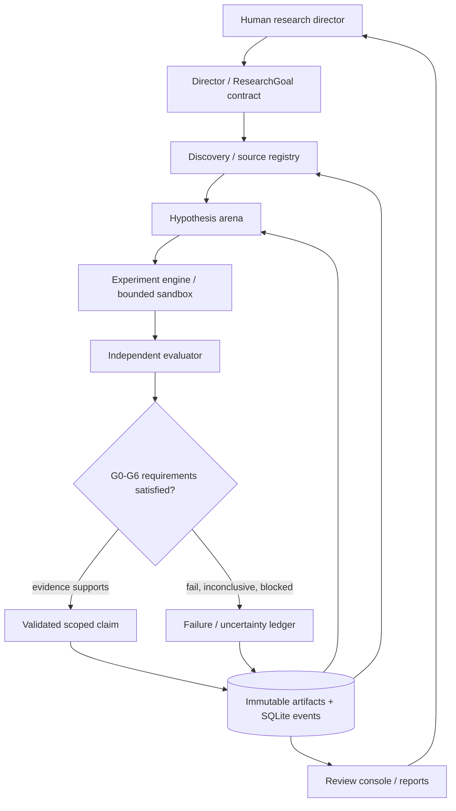
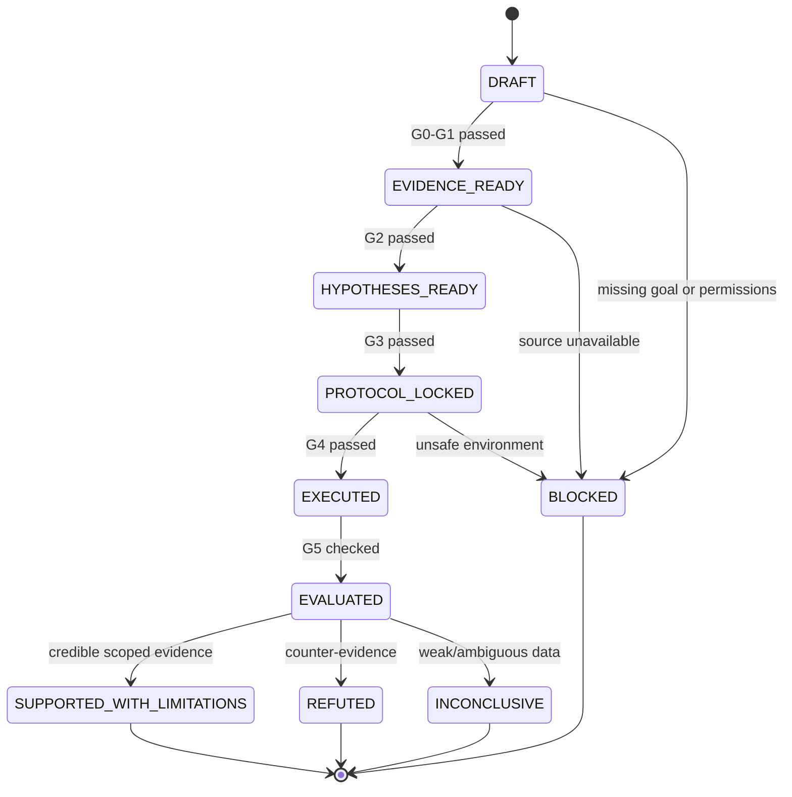

# Architecture — Research Evolution Engine

**Version:** v0.1 · **Status:** preliminary technical design, not implemented · **Date:** 2026-11-06

## 1. Architectural invariants

1. **Evidence before assertion.** Every substantive scientific claim must link to an immutable dataset, run and evaluator verdict.
2. **Evaluator independence.** Agents cannot silently rewrite evaluation protocols, held-out data or promotion criteria.
3. **Reproducibility by default.** Versioned code, parameters, random seeds, environments, data snapshots and outcomes.
4. **Fail closed.** Missing data or a failed gate produces `BLOCKED`, `REFUTED` or `INCONCLUSIVE`, never fabricated results.
5. **Local-first, API-optional.** State and evidence live locally; models are replaceable external services, not the database of record.
6. **Bounded autonomy.** CPU, cost, memory, time, permissions and parallelism are explicit budgets.
7. **Human accountability.** Humans set goals and approve consequential external actions or publication.

## 2. Architecture transfer map

| Reference | Publicly documented core | Adopted design | Boundaries / caveats |
| --- | --- | --- | --- |
| [Google Co-Scientist](https://docs.cloud.google.com/gemini/enterprise/docs/co-scientist) | Supervisor and six agents: generation, reflection, ranking, evolution, proximity and meta-review | Hypothesis arena, tournament, counterarguments, synthesis | Comparable **pattern**, not Google's private Gemini runtime or scientific results |
| [Sakana AI Scientist-v2](https://github.com/SakanaAI/AI-Scientist-v2) | Experiment manager and progressive agentic tree search, runnable code and paper generation | Bounded search graph, experiment manager and experiment lineage | Repo warns about generated-code risk; its original GPU/dependency stack is not assumed to run on macOS unchanged |
| [Google AlphaEvolve](https://docs.cloud.google.com/gemini/enterprise/docs/alphaevolve/developer-guide/architecture-and-workflows) | LLM ensemble, program DB, prompt sampler and task-supplied evaluator | Candidate archive + controlled mutation + external scoring | The quality of the **domain evaluator** determines whether selection is meaningful |
| [FutureHouse Robin](https://www.futurehouse.org/research/demonstrating-end-to-end-scientific-discovery-with-robin-a-multi-agent-system) | Hypothesis, strategy, data analysis and follow-up in biological research | Evidence-to-experiment-to-evidence loop | Physical experimentation requires separate licensed, controlled infrastructure; first version is computational only |
| [Sakana Agentic Scientist](https://pub.sakana.ai/agentic-scientist/) | Executable task specs, coding-agent workers, rubrics, ablations, evidence maps and human oversight | Research harness and audit-ready outputs | Its own authors identify shortcomings in literature integration and state-of-the-art baselines |
| [Karpathy autoresearch](https://github.com/karpathy/autoresearch) | Narrow editable code surface; fixed evaluation and time budget | Fixed evaluator, minimal mutable code, short test iterations | Original repo requires NVIDIA hardware; the **principle** is portable, not the benchmark runtime |

## 3. Two views of the same system

**Scientific functions (six):** Discovery → Hypothesis → Experiment → Evaluation → Evolution → Memory & Report.

**Software packages (eight):** Director, Discovery, Hypothesis, Experiment, Evaluation, Evolution, Memory, UI. One package may host several scientific functions; the first release is **one process + sandbox worker**, not eight servers.



### Subsystem contracts

| Subsystem | Input | Output | Must not do |
| --- | --- | --- | --- |
| `director` | research brief, budget, policy | run plan, task states, approval requests | silently expand goal or spend limit |
| `discovery` | search queries, time window, approved sources | versioned source packets with provenance | invent sources or treat snippets as full-text proof |
| `hypothesis` | evidence packets, negative memory | structured, falsifiable candidates and critiques | label hypothesis as empirically verified |
| `experiment` | approved protocol, code, manifest | executed runs, logs, metrics, artifacts | modify frozen evaluator or escape sandbox |
| `evaluation` | run outputs, locked score spec, hidden split | independent verdict, uncertainty and failure reasons | accept self-reported scores without checking |
| `evolution` | evaluated candidates, budget | selected/mutated next proposals | optimize on held-out set repeatedly |
| `memory` | append-only events, hashes | durable lineage, snapshots and reproducible bundles | silently delete or rewrite previous negative results |
| `ui` | read-only state, permitted review actions | traceable decisions, pause/approve/reject | claim non-existent results or submit externally without approval |

## 4. Agent roles (logical roles, not mandatory separate processes)

- **Supervisor:** decomposes an authorized goal into bounded steps, assigns available budgets and halts on failed gates.
- **Researcher / Retriever:** collects primary sources and authentic datasets; annotates time, license and extraction limits.
- **Hypothesis Generator:** constructs at least three competing, testable explanations; explicitly specifies falsifiers.
- **Skeptical Reviewer:** searches for data leakage, causal confusion, adversarial examples and unconsidered baselines.
- **Ranking / Diversity Controller:** pairwise prioritization and clustering; ranking is a **heuristic**, not evidence of truth.
- **Experiment Designer:** writes preregistered protocol, comparison group and locked evaluation spec.
- **Executor:** produces candidate code and runs approved computations in isolation.
- **Independent Verifier:** scores metrics from raw artifacts and enforces G0–G6.
- **Evidence Auditor:** checks source URLs, table/figure values, statistical claims and report-to-run links.

The MVP may instantiate these as **sequential model calls with role-specific instructions**. Multi-model debate and parallel workers are optimization choices after correctness is established.

## 5. State and data model

Eight first-class research records:

1. `ResearchGoal`: problem, domain, outcome metric, baseline, scope, explicit permissions, stop rules.
2. `Source`: title, URL or origin, author, publish/retrieval dates, license, `sha256`, claim coverage.
3. `Hypothesis`: candidate statement, mechanism, falsifier, alternatives, evidence references, status.
4. `Experiment`: protocol ID, controls, dataset split, immutable score spec, expected failure signals.
5. `Run`: hypothesis/experiment ID, git commit, container image digest, seed, parameters, logs, artifacts.
6. `Evaluation`: metric, uncertainty, comparison to baseline, gate decisions, evaluator version.
7. `Decision`: accept/reject/revise/stop, reason, author/agent ID, timestamp and links.
8. `Artifact`: report, plot, dataset manifest, model or code path, hashes and publication status.

Example **proposed** run record (not an observed result):

```json
{
  "run_id": "R001-EXP003-RUN001",
  "goal_id": "R001",
  "hypothesis_id": "H003",
  "experiment_id": "EXP003",
  "code_commit": "<recorded-on-run>",
  "dataset_manifest_sha256": "<recorded-on-run>",
  "evaluator_version": "eval-v0.1-locked",
  "split": "chronological-holdout",
  "seed": 42,
  "state": "PENDING",
  "metrics": null,
  "verdict": "NOT_EVALUATED"
}
```

### Append-only research history

- `events.jsonl` = authoritative audit trail for transitions and permissions.
- `research.db` (SQLite) = query-friendly indexing and checkpoints.
- `data/*.parquet` = immutable datasets and intermediate tables.
- `runs/<id>/` = per-run manifests, stdout/stderr, metrics and checksums.
- `reports/<id>.md` = claims with evidence references; generated PDF is optional in a later phase.

Use deterministic run IDs, content hashes, atomic writes, idempotency keys and checkpoints to avoid duplicate side effects when resuming.

## 6. Research-loop state machine



`SUPPORTED_WITH_LIMITATIONS` is deliberately not `DISCOVERED_TRUTH`. Reports must state limitations, exact split, tested conditions and lack of external replication where relevant.

## 7. Evaluator and evolution isolation

```text
Generation/Mutation API (editable workspace)
           |
           v
Candidate program + parameter manifest
           |
           v
Sandbox execution (read-only data mount, no network by default)
           |
           v
Measured artifacts --> IMMUTABLE evaluator + negative controls
                                      |
                                      v
                     verdict + score + uncertainty + evidence hash
                                      |
                     +----------------+------------------+
                     |                                   |
                 ACCEPT                              REJECT / REVISE
                     |                                   |
                archive winner                    archive failure
                     +----------------+------------------+
                                      |
                              budgeted next cycle
```

For performance claims, use a *locked primary metric*, time-consistent holdout, baseline, repeatability and explicit handling of multiple comparisons. Elo/LLM critique can **prioritize**, but cannot replace empirical validation.

## 8. Proposed deployment

| Layer | Tool | Why | First-release boundary |
| --- | --- | --- | --- |
| Programming | Python 3.12 | scientific ecosystem | locally installed and pinned |
| Orchestration | LangGraph | checkpointed state / human interrupts | avoid unnecessary parallelism |
| Model calls | provider-specific SDK or LiteLLM | swappable model policy | enforce request ceilings and separate keys |
| Database | SQLite | local and inspectable | migrations/backups required |
| Data | Parquet and file hashes | immutable reproducibility | do not store credentials or private raw datasets in Git |
| Sandboxing | Docker with strict profiles | isolate untrusted generated code | no host Docker socket, no writable host binds, network disabled unless permitted |
| Testing | pytest, deterministic evaluators | independent gate enforcement | no evaluator modifications from workers |
| Viewer | standalone HTML initially; Streamlit later | lightweight review | static atlas is **not** a live dashboard |
| Optional remote access | authenticated private reverse proxy | review from another device | never expose unauthenticated control endpoints |

**Hardware expectation:** local Mac mini orchestrates and can run small CPU experiments; specialized CUDA-heavy training requires separate compatible GPU resources and costs.

## 9. Security / risk model

Threats include prompt injection in retrieved papers and repositories, agent-generated malicious code, hidden-test contamination, model hallucinations, data leakage, accidental external API writes and runaway usage fees.

Controls: isolated execution; least privilege; separate read-only source ingestion and privileged secret-bearing API layer; allowlisted domains; strict filesystem and resource limits; no network in generated-code containers by default; immutable evaluator; no automatic publish, commit, push or trading; approval interrupts; audit logs; budget circuit breakers.

Sandbox **limitations** and bypass resistance must be penetration-tested; this design alone does not certify isolation.

## 10. Domain-adapter interface

The core should be independent of any dataset or scientific field. A domain adapter supplies:

```python
class ResearchDomainAdapter:
    def source_manifest(self): ...
    def define_baseline(self): ...
    def build_splits(self): ...
    def immutable_evaluator(self): ...
    def negative_controls(self): ...
    def validate_claim_scope(self, evaluation): ...
```

Potential next adapters: `market_microstructure` (R001), `causal_inference`, `software_performance`, `formal_mathematics`. Each requires its own evidence standards; all are **future proposals**.

## 11. Hard design rules for implementation agents

- No fabricated paper citations, source text, performance metrics or successful run logs.
- No arbitrary upstream license copying; keep provenance and attribution.
- No claiming the first version implements Google/Sakana/FutureHouse internal systems.
- No generated-code access to stored API keys or hidden evaluation set.
- No hidden evaluator edits or repeated tuning on the final test split.
- No production-money or third-party external actions without authorization.
- A complete negative or inconclusive research cycle counts as successful **engineering**, not a successful scientific hypothesis.

Next: [R001 and acceptance plan](IMPLEMENTATION_PLAN.md) · [Instructions to build](CODEX_DIRECTIVE.md).
