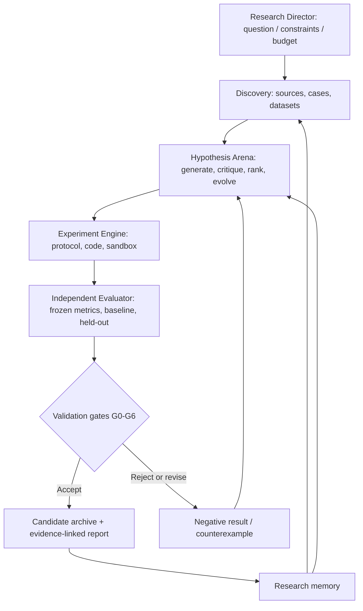

# Research Evolution Engine (REE)

> **Evidence-first, local-first autonomous scientific research — from research question to testable hypothesis, reproducible experiment, independent validation, and iterative improvement.**

**Status:** `DESIGN / PRE-IMPLEMENTATION`  
**Specification:** `v0.1` · **Snapshot:** `2026-11-06 (Asia/Seoul)`  
**Evidence status:** No running implementation, completed E2E experiment, or validated scientific result has been demonstrated in the source discussion.

[Research State](RESEARCH_STATE.md) · [Architecture](ARCHITECTURE.md) · [Implementation Plan](IMPLEMENTATION_PLAN.md) · [Codex Directive](CODEX_DIRECTIVE.md) · [Visual Atlas](RESEARCH_ATLAS.html) · [References](REFERENCES.md)

## 1. Mission

Build a **reusable autonomous research engine** that takes a problem and a measurable success criterion and performs:

1. **Discovery:** retrieve scientific literature, authentic cases and reproducible data.
2. **Hypothesis:** propose multiple falsifiable explanations; critique, rank, diversify and refine them.
3. **Experiment:** turn proposals into bounded, executable computational experiments.
4. **Evaluation:** separate code execution from scientific claims; test against frozen metrics, controls and held-out data.
5. **Evolution:** retain valid improvements and negative findings; choose follow-on experiments under a fixed budget.
6. **Memory & reporting:** preserve provenance, artifacts, decisions, failures and claims with explicit evidence links.

The system should be **domain-adaptable**, not a special-purpose trading bot. The first benchmark is a bounded computational market-microstructure research study (R001); subsequent adapters may target software engineering, causal inference, mathematics and other computational sciences.

## 2. What exists today?

| Workstream | Status | Evidence |
| --- | --- | --- |
| Mission and scope | **Drafted** | This README and research state |
| Comparative architecture | **Drafted** | `ARCHITECTURE.md` |
| Six-stage pipeline and eight implementation packages | **Designed, untested** | `ARCHITECTURE.md` |
| Seven validation gates and initial security controls | **Proposed, untested** | `IMPLEMENTATION_PLAN.md` |
| R001 benchmark protocol | **Proposed, no real run** | `IMPLEMENTATION_PLAN.md` |
| Agent runtime, data pipelines, sandbox, UI | **Not verified as implemented** | No run or code evidence supplied in this conversation |
| Independent validation / reproducibility | **Not executed** | No logs, metrics or held-out results |
| GitHub publication | **Not performed by these artifacts** | Local package prepared for review and upload |

**Design complete ≠ implementation complete ≠ scientific validity.** Each claim must be scoped to its actual evidence.

## 3. Design inspirations (not proprietary reproductions)

| Source system | Publicly described mechanism | REE interpretation |
| --- | --- | --- |
| [Google AI Co-Scientist](https://deepmind.google/blog/co-scientist-a-multi-agent-ai-partner-to-accelerate-research/) | Generate, reflect, rank, evolve, deduplicate, meta-review under a supervisor | Hypothesis arena / structured debate |
| [Sakana AI Scientist-v2](https://github.com/SakanaAI/AI-Scientist-v2) | Experiment manager, agentic tree search, automated computational studies | Bounded experiment tree / execution manager |
| [Google AlphaEvolve](https://docs.cloud.google.com/gemini/enterprise/docs/alphaevolve/developer-guide/architecture-and-workflows) | LLM proposals, candidate program DB, prompt sampling, task-specific evaluator | Program evolution with frozen evaluation |
| [FutureHouse Robin](https://github.com/Future-House/robin) | Literature, hypothesis, experimental strategy, data analysis and follow-up | Evidence-to-experiment feedback loop |
| [Sakana Agentic Scientist (2026)](https://pub.sakana.ai/agentic-scientist/) | Research harness, rubric-based experiments, ablation, evidence map, human checks | Evidence-grounded research governance |
| [Karpathy autoresearch](https://github.com/karpathy/autoresearch) | Restricted edit surface, immutable evaluator, fast comparison loop | Small, auditable experiment kernel |

This repo is an **original integration design** based on public descriptions. It does not contain, imply access to, or claim equivalence with nonpublic model weights, internal research data, or proprietary infrastructure.

## 4. Proposed architecture



**Hard boundary:** an agent's assertion of success is not proof. Only the independent evaluator may promote an experimental claim, and a human approves external publication or consequential actions.

## 5. Initial research benchmark — R001

**Question:** Are identifiable cryptocurrency price discrepancies sufficiently repeatable and predictive *before the event*, and do they survive realistic fees, slippage, latency, liquidity and out-of-sample validation?

- Gather up to 30 **discovery cases** for qualitative pattern identification; **do not treat 30 selected examples as statistical proof**.
- Form at least three competing, falsifiable hypotheses.
- Freeze the evaluation metric and chronological train/validation/held-out split before final testing.
- Compare against a documented naive baseline and negative controls; report effect sizes and uncertainty.
- Execute **simulation only**. No live orders, withdrawals, wallets, personal data extraction, or real-world actions.
- The valid terminal outcomes are `SUPPORTED_WITH_LIMITATIONS`, `REFUTED`, `INCONCLUSIVE`, and `BLOCKED` — not just “success”.

## 6. Local-first deployment target

- **Controller:** Mac mini (24 GB RAM) as the always-on orchestrator and storage host.
- **Review console:** secondary MacBook / mobile device via an authenticated private interface.
- **Models:** swappable provider APIs behind a common adapter; secrets remain outside generated-code sandboxes.
- **Stack (proposed):** Python 3.12, LangGraph, SQLite, Parquet, pytest, isolated Docker execution, Streamlit.
- **Principle:** one reliable sequential research cycle before parallel workers, long-running queues or extra services.

These are **candidate selections**; runtime compatibility, expenses and security must be checked during implementation.

## 7. Roadmap

| Stage | Target | Definition of done |
| --- | --- | --- |
| Spec freeze | Now | Source links, objectives, acceptance gates and unknowns documented |
| MVP vertical slice | **48-hour engineering target, not a guarantee** | One real R001 computational workflow runs to a terminal verdict and writes evidence |
| Verification hardening | After MVP | At least 12 safeguard tests; reproducible artifacts; restart and cost cap work |
| Multi-domain expansion | **30-day planning horizon, not a guarantee** | Domain adapters, swappable evaluators, optional bounded parallel search |

## 8. How to use this repository today

This release is **documentation-only**. There is intentionally **no `pip install` or `run` command yet** because no working runtime has been delivered or verified. Start with [`CODEX_DIRECTIVE.md`](CODEX_DIRECTIVE.md) to build the first testable vertical slice.

For a documentation-only first GitHub push (after your own review):

```bash
git init
git add README.md RESEARCH_STATE.md ARCHITECTURE.md IMPLEMENTATION_PLAN.md CODEX_DIRECTIVE.md RESEARCH_ATLAS.html REFERENCES.md .gitignore
git commit -m "docs: initial evidence-first research engine specification"
# Create an empty GitHub repository named research-evolution-engine, then:
git branch -M main
git remote add origin https://github.com/<YOUR_GITHUB_HANDLE>/research-evolution-engine.git
git push -u origin main
```

The URL contains an intentional placeholder; repository creation, authentication and push have **not** been performed.

## 9. Research integrity and publication

Record primary sources and licensing; attribute reused code; do not assume upstream source licenses allow arbitrary copying. Do not publish unverified scientific claims as validated discoveries, and explicitly disclose AI involvement in externally submitted work according to applicable venue rules.

**Current gate:** `DESIGN → BUILD (pending)`. The first useful next action is **implementation of a real, bounded, measurable R001 run**, not expansion of the agent count.
